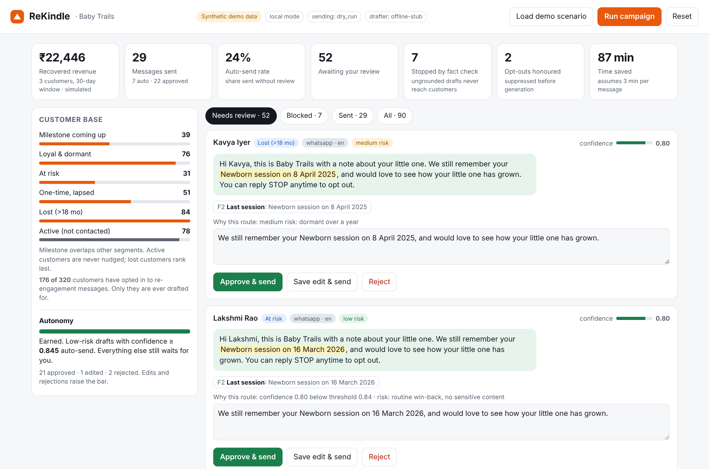

# ReKindle

An AI commerce-intelligence agent that turns a merchant's past-customer database into recurring revenue: it finds dormant customers, drafts personal WhatsApp and email re-engagement with Gemini, fact-checks every draft, and keeps the owner in control. **Human-supervised first, autonomy earned.**

Built for the Google Cloud x Hack2skill **AI Builder Cup** (JAPAC). Pilot partner: Babytrail Photography, whose booking system ([baby-trails](https://github.com/JayMandava/baby-trails)) is the data source and WhatsApp channel. See [docs/BABYTRAILS_INTEGRATION.md](docs/BABYTRAILS_INTEGRATION.md) for what that system provides, what it lacks, and the changes the pilot needs.



## How it works

```
BigQuery (RFM + dormancy + journey)         deterministic: who, and when (from Baby Trails bookings)
   -> opt-in + suppression gate             deterministic: before any generation
   -> Gemini on Vertex AI (response_schema) writes; every claim cites a fact id
   -> fact-verification guardrail           deterministic: numbers, names, offers, tone, memories
   -> risk tier + trust-earning router      deterministic
   -> owner cockpit (Firestore)  |  auto-send (low risk, earned trust)
   -> WhatsApp (approved Marketing template); Gmail optional
   -> replies (STOP in any language) and orders -> events -> Looker Studio
```

Diagrams: [architecture](docs/diagrams/architecture.png), [process flow](docs/diagrams/flow.png). Deck: [docs/deck](docs/deck/).

### The trust policy (one story, used everywhere)

- Nothing auto-sends until the owner has made **20 decisions** (warm-up).
- After that, only **low-risk** drafts with confidence at or above a **learned threshold** auto-send. Journey messages (they reference the baby's age) and discounts are always **high** risk and always go to the owner. VIPs, customers dormant over a year, and anyone whose history is a maternity session are **medium** and also go to the owner.
- Unedited approvals lower the threshold (floor 0.70); edits (+0.02) and rejections (+0.04) raise it (ceiling 0.95).
- Edited drafts are re-verified; an edit that introduces something ungrounded is refused.

### What the guardrail checks (`rekindle/verifier.py`)

Every claim must quote the message verbatim and be supported by the fact it cites. Every number must sit inside a claim whose fact contains it (a number that is true elsewhere is still wrong here). Names, offers (merchant-approved only), links, pressure/urgency, guarantees and health claims are blocked. A sentence that recalls something about the customer ("you told us you loved...") must be backed by a cited claim, and no long sentence may be entirely uncited. Opt-out lines are appended by the system, never written by the model. On failure the draft is regenerated once with the reasons; if it still fails it is **blocked**.

Measured on the synthetic dataset with `python scripts/eval_guardrail.py`: 13 corruption types x all 145 outreach targets = **1,864 corrupted drafts, 1,864 blocked, 0 unsafe auto-sends, 0% of clean drafts wrongly blocked**. This is our own corruption set, not an independent benchmark, and it exercises the guardrail, not Gemini.

## Run it locally (no cloud credentials)

```bash
pip install -r requirements-dev.txt
python -m pytest -q                                   # 65 tests
REKINDLE_AS_OF=2026-10-18 uvicorn rekindle.api:app_factory --factory --port 8080
# open http://localhost:8080 and click "Load demo scenario"
```

Local mode runs the **same `sql/segments.sql`** against in-memory SQLite (a two-macro dialect shim), an in-memory store, a dry-run sender, and a deterministic **offline drafter that is not an LLM**. It deliberately emits some bad drafts (`REKINDLE_CHAOS`, default 0.2) so the guardrail is visible. The data is synthetic but shaped like Baby Trails' Airtable `Bookings` and goes through the same adapter real data will (`rekindle/babytrails.py`); the 55% opt-in rate in it is illustrative, the real rate today is zero. To run on a real export: `REKINDLE_BOOKINGS_JSON=export.json` or `python scripts/import_babytrails.py --airtable`. Owner decisions, replies and orders in the demo scenario are simulated.

## Run it on Google Cloud

```bash
export PROJECT=your-project REGION=us-central1
./deploy/setup_gcp.sh      # APIs, BigQuery dataset/tables, Firestore, synthetic data, Looker view
./deploy/deploy.sh         # Cloud Run, REKINDLE_MODE=gcp, SEND_MODE=dry_run
```

Then in Looker Studio create a data source on `rekindle.v_campaign_performance` (BigQuery). Real sending is off until you set `SEND_MODE=live` and provide the WhatsApp Cloud API and Gmail credentials in `.env.example`. WhatsApp outreach to dormant customers must use a pre-approved **Marketing** template; `rk_reengage_v1` (wording in the integration doc) has three variables: first name, merchant name, personalised sentence. Templates are approved per language, so the pilot is English-only.

## Status: what is and is not verified

| Part | Status |
|---|---|
| Segmentation SQL, opt-in/STOP, verifier, router, trust learning, engine, API, cockpit | Tested (65 tests) and exercised end to end locally |
| Baby Trails adapter (`babytrails.py`, `import_babytrails.py`) | Tested against Airtable-shaped rows written from Baby Trails' source; **not yet run against the live Airtable base** |
| `sql/*.sql` | Parsed as valid BigQuery SQL (sqlglot); **not yet run against BigQuery** |
| Gemini adapter | Request config and structured-output schema validated against the real SDK; call logic tested with a fake client; **not yet run against live Gemini** |
| Firestore store, BigQuery data source/events | Implemented; **not yet run against real services** |
| WhatsApp Cloud API and Gmail senders | Implemented; **not exercised** (dry-run is the default) |
| Dockerfile, deploy scripts | Written; **not yet run** |
| Looker Studio dashboard | SQL view provided; the dashboard itself still has to be built in the console |

## Known limitations

- **No opt-in exists in Baby Trails today**, so no real customer is currently eligible. The studio must add the opt-in question (proposal in the integration doc); until then ReKindle correctly drafts for nobody. Its existing `Marketing` field is photo-use consent and is never used as messaging consent.
- Baby Trails stores the baby's age, not a birth date, and no child name. Milestones are estimates, quoted by month; drafts say "your little one".
- Replies and STOP must be routed to ReKindle by Baby Trails, which owns the WhatsApp webhook (details in the integration doc). That change is proposed, not made.
- English only for the pilot (WhatsApp templates are per language); Tamil is roadmap.
- The verifier is lexical and rule-based. It cannot see a paraphrased falsehood that uses none of the patterns above ("Aarav must be walking by now"). A Gemini entailment check as a second layer is the planned next step.
- Capitalised-name checks do not apply to non-Latin scripts; numbers, offers, links and recollection rules still do.
- Offer wording (`Merchant.offers`) and journey timings are placeholders until the studio approves them.
- The cockpit has no authentication. Put it behind IAP or Firebase Auth before real customer data (`deploy.sh` says so).
- "Time saved" assumes 3 minutes per hand-written message (`ASSUMED_MINUTES_PER_MESSAGE`).
- Attribution is last-touch within 30 days.

## Layout

```
rekindle/   config, models, babytrails (adapter), segmentation, consent, drafting (Gemini + offline), verifier, routing, engine, store, channels, api, demo, ui/
sql/        segments.sql (BigQuery + SQLite), schema.sql, dashboard.sql
tests/      65 tests          scripts/  eval_guardrail.py, import_babytrails.py, build_deck.py
deploy/     setup_gcp.sh, deploy.sh      docs/  deck, diagrams, screens, guardrail_eval.json
```
